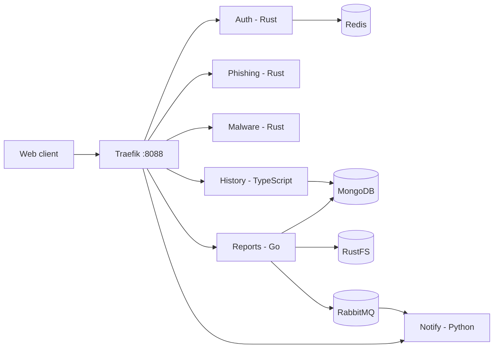

# ForgeHarbor

ForgeHarbor is a local threat-detection platform with a React web client and Rust, Go, TypeScript, and Python services. Traefik routes browser and API traffic. The development stack uses MongoDB, Redis, RabbitMQ, and RustFS for S3-compatible report storage.

## Current capabilities

- User signup and login with RS256 JWTs.
- URL analysis through the Phishing service and Gemini.
- File analysis through the Malware service and VirusTotal.
- Owner-scoped scan history, report metadata/downloads, and notifications.
- A browser client served through the Traefik gateway.

Scans currently run synchronously. The project roadmap tracks asynchronous orchestration, a shared scan schema, edge authentication, and broader regression coverage as open work. See the [architecture review](docs/obsidian/01-Architecture/Architecture-Review.md) and [backlog](docs/obsidian/06-Roadmap/Backlog.md).

## Architecture



The development Compose file binds published ports to loopback. Service and infrastructure ports are for local debugging; production deployments should keep them internal and apply an edge authentication policy.

## Prerequisites

- Docker Desktop with Docker Compose v2
- Git
- Node.js 22 for local JWT key setup
- Gemini and VirusTotal API credentials for live scans

## Local setup

1. Clone the repository and enter its directory.

   ```powershell
   git clone https://github.com/m33ha1/forgeharbor.git
   cd forgeharbor
   ```

2. Create the local environment file and replace provider placeholders in `config/.env`. Set storage credentials to match the RustFS configuration in the development Compose file. Do not commit this file.

   ```powershell
   Copy-Item config/.env.example config/.env
   ```

3. Generate the Auth RSA key pair and copy its public key to the Rust services that verify tokens. The setup command refuses to replace existing keys and checks that all copies match.

   ```powershell
   node scripts/setup-jwt-keys.mjs
   ```

   Keep the private key and `config/.env` local. Reports, History, and Notify mount the Auth public key from Compose.

4. Build and start the stack.

   ```powershell
   .\scripts\dev.ps1 build
   .\scripts\dev.ps1 up
   .\scripts\dev.ps1 health
   ```

To start with a rebuild, run `docker compose -f deploy/compose/docker-compose.dev.yml up -d --build`.

## Local URLs

Open the web client through the gateway. Signed-in pages are `/app/dashboard`, `/app/history`, and `/app/profile`; `/history` is the authenticated History API, not a browser page. Login returns to the requested protected page.

| URL | Service |
|---|---|
| `http://localhost:8088` | Traefik gateway and web client |
| `http://localhost:8000` | Traefik dashboard |
| `http://localhost:3000` | Web container direct access |
| `http://localhost:8080`–`8085` | Auth, Phishing, Malware, History, Reports, Notify direct ports |
| `http://localhost:15672` | RabbitMQ management UI |
| `http://localhost:9001` | RustFS console |

Published ports are bound to `127.0.0.1`. The gateway listens on host port `8088`; host port `80` is not used.

## API routes

Use `http://localhost:8088` as the API base. Browser login sets a one-hour HttpOnly, SameSite=Strict session cookie; the Web app never stores JWTs in browser storage. Protected routes accept that cookie or a valid RS256 bearer token. Keep `AUTH_COOKIE_SECURE` enabled behind production HTTPS; only the local Compose gateway disables it for loopback HTTP. Each service keeps its public prefix; Traefik does not strip or rewrite it.

| Service | Routes |
|---|---|
| Auth | `POST /auth/signup`, `POST /auth/login`, `POST /auth/logout`, `GET /auth/me`, `GET /auth/jwks`, `GET /auth/health` |
| Phishing | `POST /phishing/v1/url/check`, `GET /phishing/health` |
| Malware | `POST /malware/v1/file/analyze`, `GET /malware/health` |
| History | `GET /history`, `GET /history/{scan_id}`, `GET /history/health` |
| Reports | `POST /reports`, `GET /reports/{id}`, `GET /reports/{id}/download`, `GET /reports/health` |
| Notify | `GET /notify`, `GET /notify/health` |

The gateway route/auth contract is documented in [`scripts/check-routes.mjs`](scripts/check-routes.mjs). Full request details and service status are in [API Contracts](docs/obsidian/09-Reference/API-Contracts.md).

## Development commands

```powershell
.\scripts\dev.ps1 status
.\scripts\dev.ps1 logs
.\scripts\dev.ps1 test
.\scripts\dev.ps1 down
```

See the [Build](docs/obsidian/03-Runbooks/Build.md) and [Run](docs/obsidian/03-Runbooks/Run.md) runbooks for service-specific commands and troubleshooting.

## Project documentation

- [Project home](docs/obsidian/00-Home.md)
- [Roadmap](docs/obsidian/06-Roadmap/Roadmap.md)
- [Security review](docs/obsidian/07-Security/Security-Review.md)
- [API contracts](docs/obsidian/09-Reference/API-Contracts.md)

## License

A `LICENSE` file is not present in the repository yet.


## Go control plane and backend MFA

Development Compose uses independent Go Auth, History and Notify processes from `apps/controlplane-go`. Existing service paths, stored identities, cookie/JWT formats and ownership behavior are preserved. Use `deploy/compose/docker-compose.language-rollback.yml` for the retained legacy implementations.

The key setup command also creates an ignored 32-byte `apps/auth-rs/config/mfa-encryption.key`. Back it up separately from JWT signing keys. API clients can enroll TOTP via `/auth/mfa/setup` and `/auth/mfa/enable`, then complete pending logins through `/auth/mfa/verify`. Recovery codes work once. Do not enroll accounts used by the unchanged browser until its separate MFA screens are deployed; the browser in this PR supports unenrolled accounts only. See [Auth](docs/obsidian/02-Services/Auth.md).

Run `scripts/check-go-parity.ps1` for isolated race-enabled MongoDB, Redis and RabbitMQ contract tests, including backend MFA. No new production deployment target is configured by this change.
