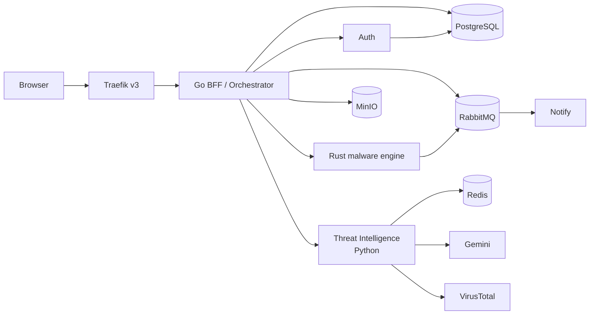

# Architecture Review — 2026-11-02

## Verdict

The architecture has a clear intent and unusually good documentation, but the services share infrastructure without sharing contracts. The result is a topology with no enforced boundaries: routing conventions differ per service, authentication is re-implemented per service, three services write the same collection with different shapes, and the queue producer and consumer never meet.

Most of the defects in [[Backlog]] are symptoms of the findings below, not independent bugs. Fixing the contracts is higher leverage than fixing each symptom.

## Follow-up status (2026-11-02)

This review is a static snapshot against the commit listed below. Since that review, D1=B routing is live, the Web image builds on Node 22, the frontend maps file results, and History, Reports, and Notify verify RS256 tokens and scope reads to the caller. Reports and Notify now share a queue. Shared edge ForwardAuth is now deployed under [[ADR-0005-shared-edge-auth]], report storage is verified end to end, and development ports are loopback-bound. Auth outage rejection/recovery are verified; production exposure and scan/event schema drift remain active risks in [[Backlog]].

## Scope and method

Reviewed on 2026-11-02 against commit `441ccdd`:

- Every note under `01-Architecture/` and `04-Decisions/`.
- `deploy/compose/docker-compose.dev.yml`.
- The source for all seven services under `apps/`.
- The frontend API client and the result/history components.

This was a static review. It did not repeat the live probes recorded in [[Security-Review]]; those findings remain valid and are referenced here, not duplicated.

## What is working

- Each language has a defensible specialty ([[ADR-0001-polyglot-boundaries]]).
- The gateway, queue, object store, and document store are real components, not stubs.
- Infrastructure services have healthchecks and named volumes.
- History already uses cursor pagination.
- The vault, runbooks, ADRs, and scripts make the system explainable.

## Findings

| ID | Severity | Finding | Primary evidence | Direction |
|---|---|---|---|---|
| AR-01 | P1 | Scans run synchronously inside the request; there is no orchestrator, timeout, retry, or idempotency | `apps/malware-rs/src/main.rs:161`, `apps/phishing-rs/src/main.rs:180` | Go orchestrator with async jobs |
| AR-02 | P0 | The gateway/service routing contract is inconsistent; History, Reports, and Notify 404 through Traefik | `apps/history-ts/src/index.ts:58`, `apps/report-go/routes/reports.go:90`, `apps/notify-py/main.py:32` | One convention, enforced by a gateway contract test |
| AR-03 | P0 | Auth is duplicated per service; History falls back to unsigned decode; Reports and Notify have none | `apps/auth-rs/src/main.rs:290`, `apps/history-ts/src/index.ts:31`, `apps/report-go/routes/reports.go:90` | Validate once at the edge; pass a trusted identity |
| AR-04 | P1 | The scan data contract drifts between writers and readers, so filters silently match nothing | `apps/phishing-rs/src/main.rs:23`, `apps/malware-rs/src/main.rs:23`, `apps/history-ts/src/index.ts:70` | One schema, one writer, explicit indexes |
| AR-05 | P1 | The event producer and consumer do not meet; there is no `scan.completed` event and no dead-letter queue | `apps/report-go/routes/reports.go:83`, `apps/notify-py/main.py:23` | Versioned envelope, DLX, idempotent consumers |
| AR-06 | P0 | Secrets enter build contexts and images; Compose blanks provider keys; infrastructure is open | `apps/auth-rs/Dockerfile:37`, no `.dockerignore`, `deploy/compose/docker-compose.dev.yml:70`, `:272` | `.dockerignore`, runtime secrets, closed ports, auth on |
| AR-07 | P2 | No OpenAPI/protobuf, no service tests, no CI on `main`, inconsistent health responses | Repository-wide | Contracts, CI, `/healthz` and `/readyz` |
| AR-08 | P2 | Observability is ad hoc `println!`/`log` with no request IDs, metrics, or traces | `apps/auth-rs/src/main.rs:113`, `apps/report-go/routes/reports.go:58` | Structured logs and OpenTelemetry |

## AR-01 — Scans run inside the request

`malware-rs` uploads to VirusTotal and then sleeps 20 seconds inside the handler (`apps/malware-rs/src/main.rs:161`). `phishing-rs` calls Gemini inline (`apps/phishing-rs/src/main.rs:180`). Neither client sets a timeout, and neither path retries.

Consequences:

- A 20–60 second request; a browser or gateway timeout is indistinguishable from a failed scan.
- No idempotency, so a retry creates duplicate records and duplicate provider cost.
- No partial-failure handling: the scan record is written only on success, and the error path for Phishing returns `phishing: true` with confidence `0`, which is a verdict rather than an error.

Direction: add the Go orchestrator from [[ADR-0002-go-control-plane]]. `POST /v1/scans` returns `202 {scan_id, status}`; the orchestrator publishes a job; workers consume; `GET /v1/scans/{id}` reports state; `scan.completed` drives History, Reports, and Notify.

## AR-02 — The routing contract is inconsistent

Traefik strips the public prefix for every service, but only some services expect that. The frontend and the service notes currently describe the mismatch as a Reports-only problem; it affects three services.

| Service | Registers | Gateway strips | Through Traefik |
|---|---|---|---|
| Auth | `/login`, `/signup`, `/me` | `/auth` | Works |
| Phishing | `/v1/url/check` | `/phishing` | Works |
| Malware | `/v1/file/analyze` | `/malware` | Works |
| History | `/history`, `/history/:id` | `/history` | **404** |
| Reports | `/reports`, `/reports/:id` | `/reports` | **404** |
| Notify | `/notifications` | `/notify` | **404** |

Health checks still pass because `/history/health`, `/reports/health`, and `/notify/health` strip to `/health`, which every service exposes. That masks the defect: the smoke tests are green while the data routes are unreachable.

**Resolved (2026-11-02):** D1=B removes the strip middleware and makes every service own its full public prefix. `scripts/check-routes.mjs` now fails if a documented route returns 404 through the gateway. The separate Traefik Docker-provider failure (FH-004) still has to be fixed before the gateway can load any route.

The frontend also calls `/notify` (`apps/web/src/services/api.js:134`) while the service exposes `/notifications`.

Direction: choose one convention and enforce it (see D1). Add a route-contract test that calls every documented endpoint through Traefik, not directly against a service port.

## AR-03 — Auth has no single boundary

Every service re-implements JWT decoding, loads its own PEM, and wraps its own middleware:

- Auth: `apps/auth-rs/src/main.rs:290`
- Phishing: `apps/phishing-rs/src/main.rs:217`
- Malware: `apps/malware-rs/src/main.rs:262`
- History: `apps/history-ts/src/index.ts:17` — allows anonymous requests and falls back to `jwt.decode` without verification when `JWT_PUBLIC_KEY` is unset (`:31`).
- Reports: no auth at all (`apps/report-go/routes/reports.go:90`).
- Notify: no auth, returns every notification (`apps/notify-py/main.py:38`).

The result is four different security postures and no single place to change or audit them. The detailed findings are in [[Security-Review]] (SEC-001 through SEC-005).

Direction: authenticate once at the edge and pass a trusted identity downstream. Either Traefik ForwardAuth to Auth, or a Go BFF that terminates the session and calls services with an internal identity. Delete the per-service JWT parsers; keep ownership checks in the data layer.

## AR-04 — The scan data contract drifts

Three services touch the same `scans` collection with different shapes:

| Writer | Result shape |
|---|---|
| Phishing (`apps/phishing-rs/src/main.rs:23`) | `{phishing, confidence, reason}` |
| Malware (`apps/malware-rs/src/main.rs:23`) | `{malicious, vendor_positives, total_vendors, report_url}` |
| History reader (`apps/history-ts/src/index.ts:70`) | filters `q.type` and `result.risk_level` |

The records use `scan_type`, not `type`, and no writer produces `risk_level`. The `type` and `risk` filters therefore return nothing. The frontend compensates with five fallback field names (`apps/web/src/components/History/ScanHistory.jsx:88-94`), which hides the drift instead of fixing it.

Direction: one result schema (`verdict`, `severity`, `provider`, `details`) written by one owner, checked in as OpenAPI or protobuf, with indexes on `(user_id, created_at)` and `(scan_type, created_at)`. This is also the migration boundary for [[ADR-0003-postgres-for-history]].

## AR-05 — The event contract does not connect

- Reports publishes to `report_events` (`apps/report-go/routes/reports.go:83`).
- Notify consumes `notifications` (`apps/notify-py/main.py:23`).
- No service emits `scan.completed`.
- Notify acknowledges a message only after a successful insert and never nacks on failure (`apps/notify-py/main.py:59-60`), so a bad message is redelivered forever with no dead-letter queue.

Direction: define one envelope — `{event_id, type, version, occurred_at, user_id, payload}` — standardize exchange and queue names, add a dead-letter exchange with retry and backoff, and make consumers idempotent by `event_id`.

## AR-06 — Secrets and infrastructure are not isolated

- Auth's runtime image copies the whole `config` directory (`apps/auth-rs/Dockerfile:37`), so `.env` and `jwt-private.pem` ship inside the image. Notify's `COPY . .` ships `aws_creds.txt` and `config.txt`.
- No `.dockerignore` exists, so build contexts include `.env`, PEMs, `node_modules`, and `dist`.
- Compose sets `environment: - GEMINI_API_KEY=${GEMINI_API_KEY}` (`deploy/compose/docker-compose.dev.yml:70-71,103-104`). That overrides the `env_file` value with a blank string, which is why the provider-key warnings appear even when local config has values.
- MongoDB (27017), Redis (6379), RabbitMQ (5672/15672), and MinIO (9000/9001) are published to the host without auth. RabbitMQ uses `guest/guest`; MinIO uses `minioadmin` (`:166`, `:170-171`).

Direction: `.dockerignore` per app, runtime secrets instead of baked files, remove the blank `environment:` overrides, bind infrastructure ports to `127.0.0.1` or drop them, enable auth, and rotate the demo credentials.

**Partially resolved (2026-11-02):** the Auth image no longer copies `config` at all; Phishing and Malware copy only `jwt-public.pem`; all three Rust apps have `.dockerignore` files. Notify still uses `COPY . .`, and the infrastructure ports remain open.

## AR-07 — No contracts, tests, or CI

There is no OpenAPI or protobuf, no service test suite, and no CI workflow on `main`. Health endpoints return three different shapes: plain text from the Rust services, JSON from History and Reports, and a different JSON from Notify. A monitor cannot treat them uniformly.

Direction: OpenAPI per service checked in, a contract test per endpoint through the gateway, `/healthz` and `/readyz`, and a GitHub Actions pipeline that builds each service, runs tests, validates Compose, checks links, and scans images.

## AR-08 — Observability is ad hoc

Every service logs with `println!`, `console.log`, or `log.Println`. There are no request IDs, metrics, or traces, so a failed scan cannot be followed from the gateway through a service and a queue.

Direction: structured JSON logs with a request ID propagated by Traefik, OpenTelemetry traces across HTTP and RabbitMQ headers, and RED metrics per service.

## Target architecture

The split keeps the credible specialties: Go owns the control plane and orchestration, Rust owns CPU-heavy analysis, Python owns enrichment and provider normalization, TypeScript owns the UI, and PostgreSQL owns relational and ownership-sensitive records.

## Decisions

### D1 — Routing convention — decided: B

| Option | Shape | Tradeoff |
|---|---|---|
| A | Gateway strips the prefix; every service owns unprefixed routes | Auth, Phishing, and Malware already work; History, Reports, and Notify change |
| B (chosen) | Gateway does not strip; every service mounts its full public prefix | Public path and direct-port path match; Auth, Phishing, and Malware change |

**Decision (2026-11-02): Option B.** The public path is the service path. The gateway performs no rewrite, so a direct-port probe and a gateway probe exercise the same route. The frontend paths were already correct. The change adds the prefix to Auth, Phishing, and Malware, adds health routes under each prefix, and removes the strip middleware. See [[ADR-0004-gateway-prefix-contract]] and the route-contract test in `scripts/check-routes.mjs`.

### D2 — Auth boundary

| Option | Shape | Tradeoff |
|---|---|---|
| ForwardAuth | Traefik asks Auth to validate each request | Smallest change; still leaves service-to-service calls unauthenticated |
| BFF (recommended) | A Go service owns the session and calls downstream services with an internal identity | More code, but one place for ownership, aggregation, and rate limiting |

### D3 — Data store timing

Keep MongoDB until the orchestrator and contracts exist, then migrate relational records to PostgreSQL per [[ADR-0003-postgres-for-history]]. Migrating before the contract is stable moves the drift into a new database.

## Recommended sequence

| Phase | Work | Exit signal |
|---|---|---|
| 0 | Auth build, Node 22 web image, Traefik provider, blank-env override, route alignment, frontend result adapter | The stack starts and every documented route works through Traefik |
| 1 | Edge auth and ownership, `.dockerignore` and runtime secrets, closed infrastructure ports, queue contract | P0 security tests pass; no secret is present in an image |
| 2 | Go orchestrator, single scan writer, versioned events with a DLQ, PostgreSQL migration | A scan survives retries and completes asynchronously |
| 3 | OpenAPI, contract tests, CI, OpenTelemetry, rate limiting | CI is green; traces cross service boundaries |

The new work is tracked as FH-033 through FH-039 in [[Backlog]] and mapped to phases in [[Roadmap]]; existing items such as FH-021 (orchestrator) and FH-022 (PostgreSQL) cover the rest.

## Related notes

- [[System-Overview]]
- [[Service-Map]]
- [[Data-Flow]]
- [[Gateway-Routing]]
- [[Security-Review]]
- [[ADR-0002-go-control-plane]]
- [[ADR-0003-postgres-for-history]]
- [[Backlog]]
- [[Roadmap]]
