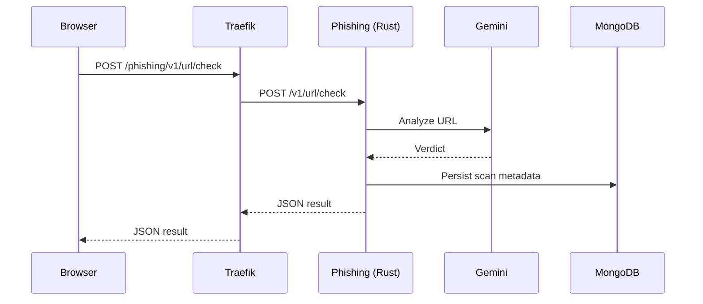
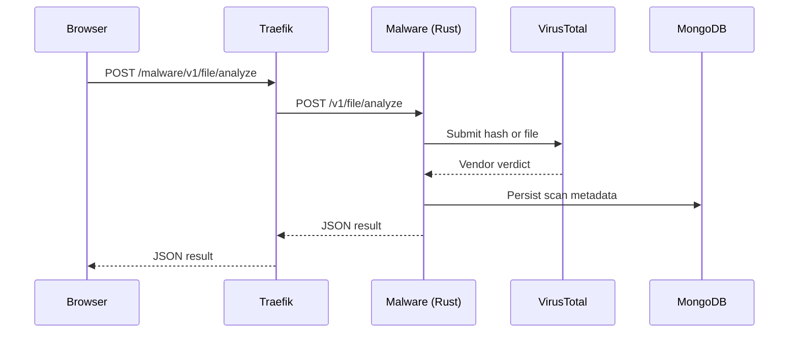
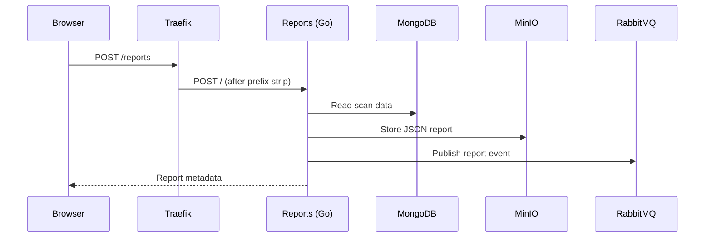
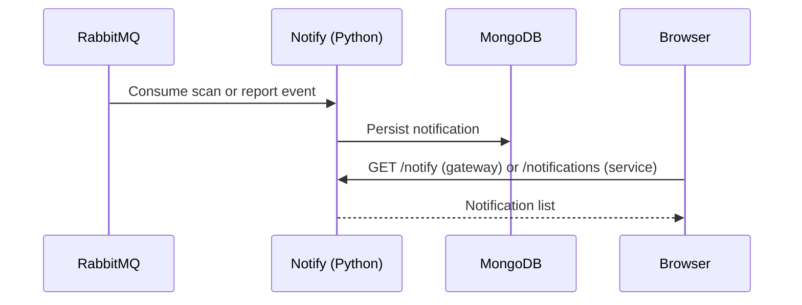

# Data Flow

## URL scan

## File scan

## Report flow

## Notification flow

## Data ownership

| Data | Current owner | Intended owner |
|---|---|---|
| Users and credentials | Auth | Auth |
| URL scan results | Phishing and History | Scan orchestrator, then History |
| File scan results | Malware and History | Scan orchestrator, then History |
| Report metadata and objects | Reports | Reports |
| Notifications | Notify | Notify |
| Audit events | None | Audit service |

## Current gaps

- Scans are synchronous and can block on Gemini or VirusTotal.
- There is no reliable `scan.completed` event between scan services, History, Reports, and Notify.
- Queue names and event shapes are not consistent across producers and consumers.
- History has no enforced ownership filter; see [[Security-Review]].
- Report creation is not authenticated, and the gateway path rewrite conflicts with the service routes.

## Related notes

- [[Service-Map]]
- [[Gateway-Routing]]
- [[History]]
- [[Reports]]
- [[Notify]]
- [[ADR-0002-go-control-plane]]
