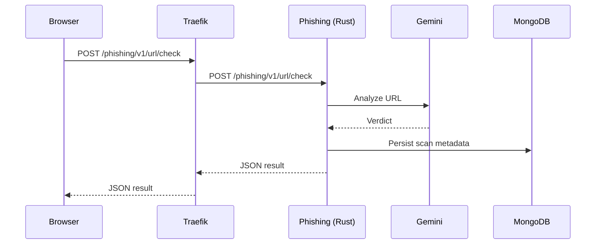
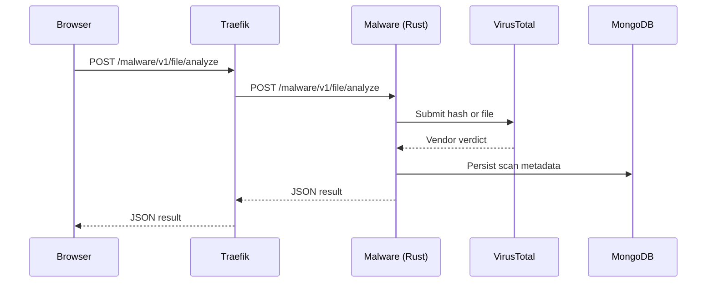
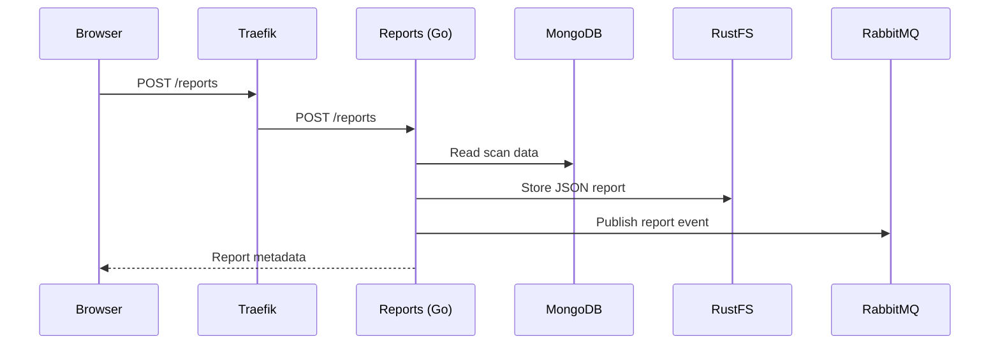
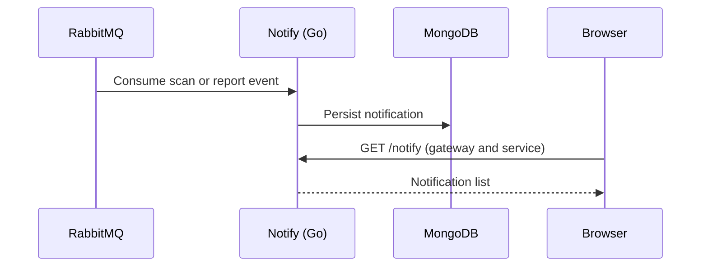
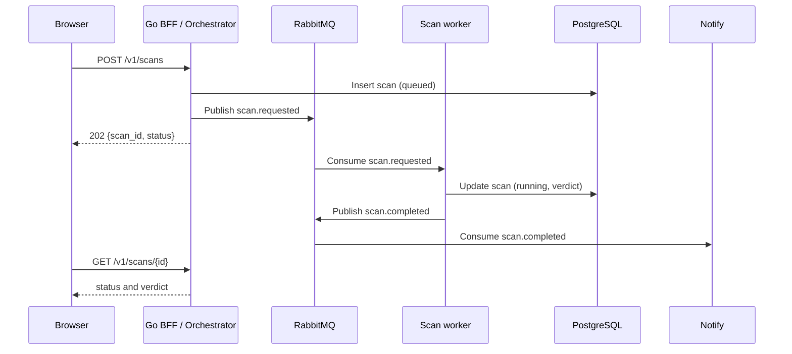

# Data Flow

## URL scan

## File scan

## Report flow

## Notification flow

Reports commits publication intent inside its metadata document and a separate relay clears it only after routed broker confirmation. Failed or ambiguous sends retain pending state. See [[ADR-0007-report-notification-outbox]].

Reports now emits the versioned report-created envelope in [[ADR-0006-report-notification-events]]. Notify validates ownership, persists each event once, confirms retry/dead handoffs before ACK, and reconnects with backoff. Three delayed retries precede dead storage; producer outbox replay is verified; broker-failure redrive guarantees remain open.

## Data ownership

| Data | Current owner | Intended owner |
|---|---|---|
| Users and credentials | Auth | Auth |
| URL scan results | Phishing and History | Scan orchestrator, then History |
| File scan results | Malware and History | Scan orchestrator, then History |
| Report metadata and objects | Reports | Reports |
| Notifications | Notify | Notify |
| Audit events | None | Audit service |

## Target flow — asynchronous scans

The orchestrator owns the scan lifecycle. Workers own provider calls. History reads the completed record instead of being written by each scanner.

## Current gaps

- Scans are synchronous and can block on Gemini or VirusTotal. Malware sleeps 20 seconds inside the request (`apps/malware-rs/src/main.rs:161`).
- There is no reliable `scan.completed` event between scan services, History, Reports, and Notify.
- **Resolved 2026-11-02:** Reports publishes user-scoped report messages to the configured `notifications` queue consumed by Notify. A versioned event envelope, retries, and dead-letter handling remain open.
- Phishing and Malware result bodies still have service-specific fields, but both now persist `result.risk_level` (`high` or `low`). History reads that field and supports legacy boolean records; a fully versioned cross-service scan schema remains open in [[Backlog]] (FH-037).
- History has no enforced ownership filter; see [[Security-Review]].
- Report creation is not authenticated, and the gateway path rewrite conflicts with the service routes.
- Notify never nacks a failed message, so a poison message is redelivered forever with no dead-letter queue.

## Related notes

- [[Architecture-Review]]
- [[Service-Map]]
- [[Gateway-Routing]]
- [[History]]
- [[Reports]]
- [[Notify]]
- [[ADR-0002-go-control-plane]]
