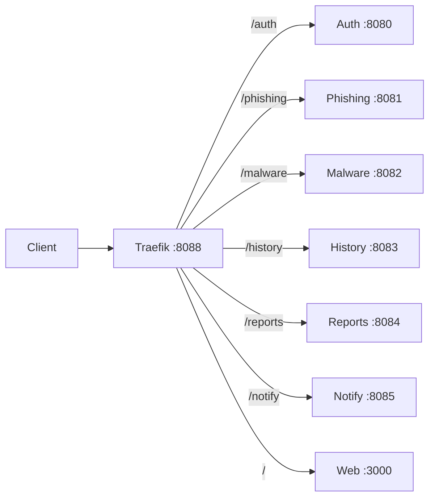

# Gateway Routing

## Public entry points

| URL | Target | Notes |
|---|---|---|
| `http://localhost:8088` | Traefik HTTP entrypoint | This is the real gateway port; the README currently says port 80 |
| `http://localhost:8000` | Traefik dashboard | Insecure dashboard enabled in development |
| `http://localhost:3000` | Web container directly | Useful for frontend debugging |
| `http://localhost:8081` | Phishing directly | Bypasses the gateway |
| `http://localhost:8083` | History directly | Bypasses the gateway |
| `http://localhost:8084` | Reports directly | Bypasses the gateway |

## Route table

| Path prefix | Router | Service port | Strip prefix | Priority |
|---|---|---:|---|---:|
| `/auth` | `fh-auth` | 8080 | `/auth` | 100 |
| `/phishing` | `fh-phishing` | 8081 | `/phishing` | 100 |
| `/malware` | `fh-malware` | 8082 | `/malware` | 100 |
| `/history` | `fh-history` | 8083 | `/history` | 100 |
| `/reports` | `fh-report` | 8084 | `/reports` | 100 |
| `/notify` | `fh-notify` | 8085 | `/notify` | 100 |
| `/` | `fh-web` | 3000 | None | 1 |

## Routing flow



## Route contract after prefix strip

Traefik strips the public prefix, so the service must register the path that remains. Only three services currently match that rule.

| Service | Public path | Service receives | Service registers | State |
|---|---|---|---|---|
| Auth | `/auth/login` | `/login` | `/login` | Works |
| Phishing | `/phishing/v1/url/check` | `/v1/url/check` | `/v1/url/check` | Works |
| Malware | `/malware/v1/file/analyze` | `/v1/file/analyze` | `/v1/file/analyze` | Works |
| History | `/history` | `/` | `/history` | **404** |
| Reports | `/reports` | `/` | `/reports` | **404** |
| Notify | `/notify` | `/` | `/notifications` | **404** |

Health checks still pass because `/history/health`, `/reports/health`, and `/notify/health` strip to `/health`, which every service exposes. That masks the defect: the smoke test is green while the data routes are unreachable.

The table assumes Traefik is routing; the Docker-provider failure below currently prevents any route from loading.

## Known defects

1. **Report prefix conflict.** The report service registers `/reports` and `/reports/:id`, but Traefik strips `/reports`. The service receives `/` and `/:id`, which do not match the intended routes.
2. **History prefix conflict.** History registers `/history` and `/history/:scan_id`, but Traefik strips `/history`. Gateway requests reach `/` and `/:scan_id` and return 404.
3. **Notify path mismatch.** The service registers `/notifications`, but Traefik strips `/notify`, and the frontend calls `/notify`. The request reaches `/` and returns 404.
4. **Inconsistent convention.** Three services are written for a stripped prefix and three are written for a full prefix. The current mix guarantees that any new service is a coin flip.
5. **Frontend path mismatch.** The frontend and README do not consistently use the gateway port or the `/notify` path.
6. **Traefik Docker provider failure.** Traefik logs `Failed to retrieve information of the docker client and server host`, so no routes load.
7. **README drift.** The README says the app is at `http://localhost` and Traefik is at `:8080`; the Compose file maps the gateway to `8088` and the dashboard to `8000`.
8. **Direct-port bypass.** Every service is published on the host, so clients can skip the gateway and its routing rules. This is acceptable for local debugging but not for a production-like setup.
9. **No data-route smoke test.** The existing probe checks `/health` only, so it cannot detect defects 1–3.

## Decision required

Two conventions are defensible; the current mix is not. See [[Architecture-Review]] (D1).

| Option | Shape | Changes required |
|---|---|---|
| A (recommended) | Gateway strips; services own unprefixed routes | History, Reports, and Notify |
| B | Gateway does not strip; services mount their full prefix | Auth, Phishing, Malware, and the Traefik labels |

Record the choice in an ADR before changing any route.

## Verification

```powershell
# Gateway is listening
Test-NetConnection 127.0.0.1 -Port 8088

# Traefik dashboard
Invoke-WebRequest http://localhost:8000/api/rawdata -UseBasicParsing

# Direct service probes
8080..8085 | ForEach-Object {
  try { (Invoke-WebRequest "http://localhost:$_/health" -UseBasicParsing -TimeoutSec 2).StatusCode }
  catch { "port $_ unavailable" }
}

# Data routes must be checked through the gateway, not only /health
# Expect 401/200, never 404, once the route contract is fixed.
```

## Related notes

- [[Architecture-Review]]
- [[Service-Map]]
- [[Reports]]
- [[History]]
- [[Notify]]
- [[Web]]
- [[Debug]]
- [[Security-Review]]
