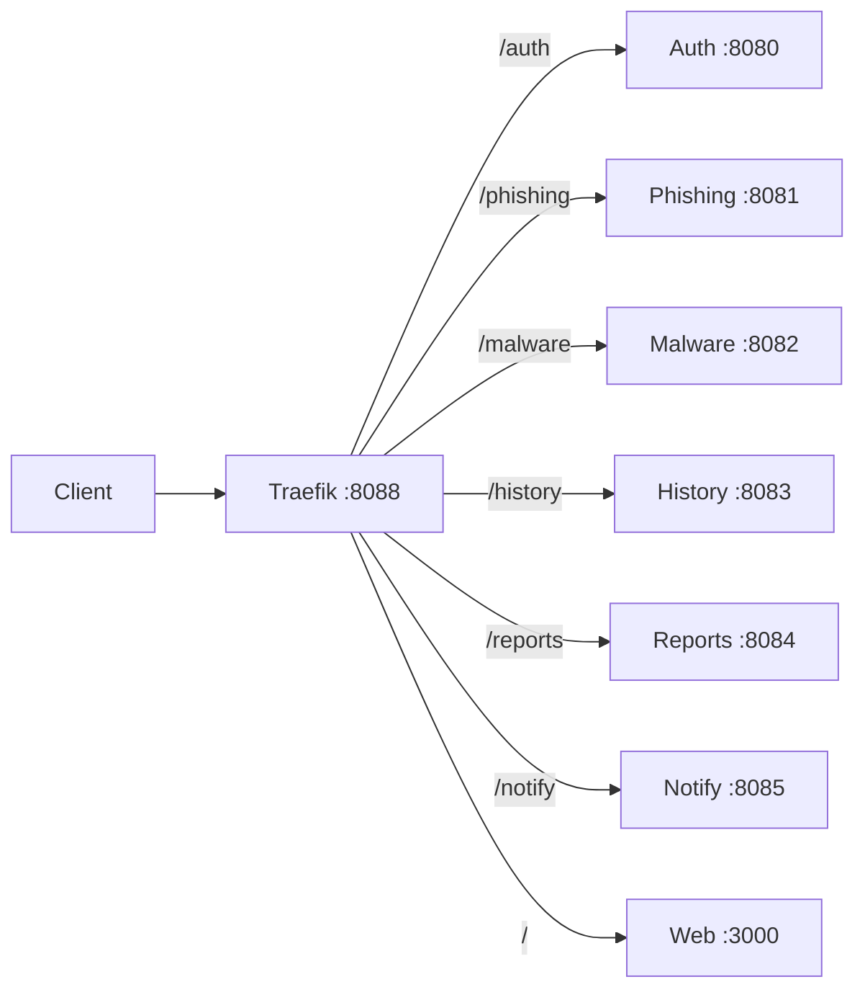

# Gateway Routing

## Public entry points

| URL | Target | Notes |
|---|---|---|
| `http://localhost:8088` | Traefik HTTP entrypoint | This is the real gateway port; the README currently says port 80 |
| `http://localhost:8000` | Traefik dashboard | Insecure dashboard enabled in development |
| `http://localhost:3000` | Web container directly | Useful for frontend debugging |
| `http://localhost:8081` | Phishing directly | Bypasses the gateway |
| `http://localhost:8083` | History directly | Bypasses the gateway |
| `http://localhost:8084` | Reports directly | Bypasses the gateway |

## Route table

| Path prefix | Router | Service port | Strip prefix | Priority |
|---|---|---:|---|---:|
| `/auth` | `fh-auth` | 8080 | `/auth` | 100 |
| `/phishing` | `fh-phishing` | 8081 | `/phishing` | 100 |
| `/malware` | `fh-malware` | 8082 | `/malware` | 100 |
| `/history` | `fh-history` | 8083 | `/history` | 100 |
| `/reports` | `fh-report` | 8084 | `/reports` | 100 |
| `/notify` | `fh-notify` | 8085 | `/notify` | 100 |
| `/` | `fh-web` | 3000 | None | 1 |

## Routing flow



## Known defects

1. **Report prefix conflict.** The report service registers `/reports` and `/reports/:id`, but Traefik strips `/reports`. The service receives `/` and `/:id`, which do not match the intended routes.
2. **Frontend path mismatch.** The frontend and README do not consistently use the gateway port or the `/notify` path.
3. **Traefik Docker provider failure.** Traefik logs `Failed to retrieve information of the docker client and server host`, so no routes load.
4. **README drift.** The README says the app is at `http://localhost` and Traefik is at `:8080`; the Compose file maps the gateway to `8088` and the dashboard to `8000`.
5. **Direct-port bypass.** Every service is published on the host, so clients can skip the gateway and its routing rules. This is acceptable for local debugging but not for a production-like setup.

## Verification

```powershell
# Gateway is listening
Test-NetConnection 127.0.0.1 -Port 8088

# Traefik dashboard
Invoke-WebRequest http://localhost:8000/api/rawdata -UseBasicParsing

# Direct service probes
8080..8085 | ForEach-Object {
  try { (Invoke-WebRequest "http://localhost:$_/health" -UseBasicParsing -TimeoutSec 2).StatusCode }
  catch { "port $_ unavailable" }
}
```

## Related notes

- [[Service-Map]]
- [[Reports]]
- [[Web]]
- [[Debug]]
- [[Security-Review]]
