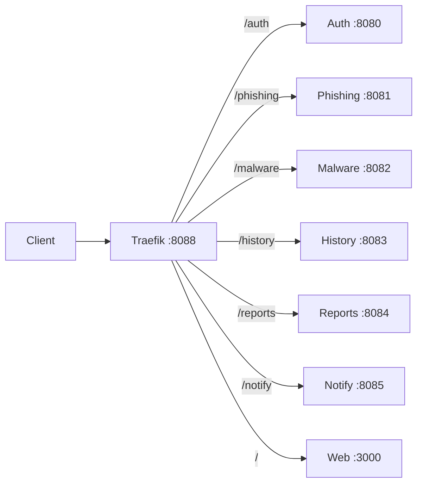

# Gateway Routing

## Public entry points

| URL | Target | Notes |
|---|---|---|
| `http://localhost:8088` | Traefik HTTP entrypoint | This is the real gateway port; the README currently says port 80 |
| `http://localhost:8000` | Traefik dashboard | Insecure dashboard enabled in development |
| `http://localhost:3000` | Web container directly | Useful for frontend debugging |
| `http://localhost:8081` | Phishing directly | Bypasses the gateway |
| `http://localhost:8083` | History directly | Bypasses the gateway |
| `http://localhost:8084` | Reports directly | Bypasses the gateway |

## Route table

| Path prefix | Router | Service port | Strip prefix | Priority |
|---|---|---:|---|---:|
| `/auth` | `fh-auth` | 8080 | `/auth` | 100 |
| `/phishing` | `fh-phishing` | 8081 | `/phishing` | 100 |
| `/malware` | `fh-malware` | 8082 | `/malware` | 100 |
| `/history` | `fh-history` | 8083 | `/history` | 100 |
| `/reports` | `fh-report` | 8084 | `/reports` | 100 |
| `/notify` | `fh-notify` | 8085 | `/notify` | 100 |
| `/` | `fh-web` | 3000 | None | 1 |

## Routing flow



## Route contract after D1=B

The gateway does not rewrite paths. Each service registers its full public prefix, so the public path, the direct-port path, and the service route are identical.

| Service | Public path | Service registers | State |
|---|---|---|---|
| Auth | `/auth/*` | `/auth/*` | Aligned |
| Phishing | `/phishing/*` | `/phishing/*` | Aligned |
| Malware | `/malware/*` | `/malware/*` | Aligned |
| History | `/history/*` | `/history/*` | Aligned |
| Reports | `/reports/*` | `/reports/*` | Aligned |
| Notify | `/notify/*` | `/notify/*` | Aligned |

Health routes follow the same rule: `/auth/health`, `/phishing/health`, `/malware/health`, `/history/health`, `/reports/health`, and `/notify/health`. The earlier failure mode — health passing while data routes returned 404 — is now covered by `scripts/check-routes.mjs`, which probes every documented route through the gateway.

## Remaining defects

1. **(Resolved) Traefik Docker provider.** `traefik:v2.10` and `v3.5` could not talk to Docker Engine 29 (API 1.41 minimum). Upgraded to `traefik:v3.7`, which loads all six service routers.
2. **README drift.** The README says the app is at `http://localhost` and Traefik is at `:8080`; the Compose file maps the gateway to `8088` and the dashboard to `8000`.
3. **Direct-port bypass.** Every service is published on the host, so clients can skip the gateway and its routing rules. This is acceptable for local debugging but not for a production-like setup.
4. **The contract test skips when the gateway is down.** `scripts/check-routes.mjs` exits 0 with a skip message if `http://localhost:8088` is unreachable, so a broken gateway is not a test failure. Run `.\scripts\dev.ps1 health` to assert that the gateway is up.

## Decision — Option B (2026-11-02)

The public path is the service path; the gateway performs no rewrite. See [[ADR-0004-gateway-prefix-contract]] for the rationale and consequences.

## Verification

```powershell
# Gateway is listening
Test-NetConnection 127.0.0.1 -Port 8088

# Traefik dashboard
Invoke-WebRequest http://localhost:8000/api/rawdata -UseBasicParsing

# Direct service probes (paths include the public prefix)
@{
  8080 = '/auth/health'
  8081 = '/phishing/health'
  8082 = '/malware/health'
  8083 = '/history/health'
  8084 = '/reports/health'
  8085 = '/notify/health'
}.GetEnumerator() | ForEach-Object {
  try { (Invoke-WebRequest "http://localhost:$($_.Key)$($_.Value)" -UseBasicParsing -TimeoutSec 2).StatusCode }
  catch { "port $($_.Key) unavailable" }
}

# Every documented route through the gateway; fails on 404
node scripts/check-routes.mjs
```

## Related notes

- [[Architecture-Review]]
- [[Service-Map]]
- [[Reports]]
- [[History]]
- [[Notify]]
- [[Web]]
- [[Debug]]
- [[Security-Review]]
