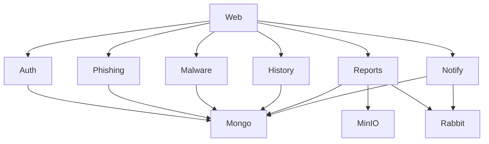

# Service Map

## Services

| Service | Language | Direct port | Public route | Primary data | Status | Note |
|---|---|---:|---|---|---|---|
| Auth | Rust | 8080 | `/auth` | MongoDB | Broken build | [[Auth]] |
| Phishing | Rust | 8081 | `/phishing` | MongoDB | Unverified | [[Phishing]] |
| Malware | Rust | 8082 | `/malware` | MongoDB | Unverified | [[Malware]] |
| History | TypeScript | 8083 | `/history` | MongoDB | Security defects | [[History]] |
| Reports | Go | 8084 | `/reports` | MongoDB, MinIO, RabbitMQ | Routing and auth defects | [[Reports]] |
| Notify | Python | 8085 | `/notify` | MongoDB, RabbitMQ | Auth and queue defects | [[Notify]] |
| Web | React + Vite | 3000 | `/` | Browser storage | Build broken | [[Web]] |

## Infrastructure

| Component | Image | Host port | Purpose |
|---|---|---:|---|
| Traefik | `traefik:v2.10` | 8088 (HTTP), 8000 (dashboard) | Edge proxy and path routing |
| MongoDB | `mongo:6.0` | 27017 | Primary document store |
| Redis | `redis:7-alpine` | 6379 | Cache and session support |
| RabbitMQ | `rabbitmq:3-management` | 5672, 15672 | Asynchronous events |
| MinIO | `minio/minio:latest` | 9000, 9001 | Report object storage |

## Dependency direction

## Status legend

| Status | Meaning |
|---|---|
| Healthy | Builds, starts, and passes its smoke test |
| Unverified | No reliable build or smoke test evidence yet |
| Broken build | Does not compile or image does not build |
| Security defects | Starts, but auth or ownership checks are missing or incorrect |
| Routing defects | Gateway and service disagree about paths |

## Related notes

- [[System-Overview]]
- [[Data-Flow]]
- [[Gateway-Routing]]
- [[Ports]]
- [[Test-Matrix]]
