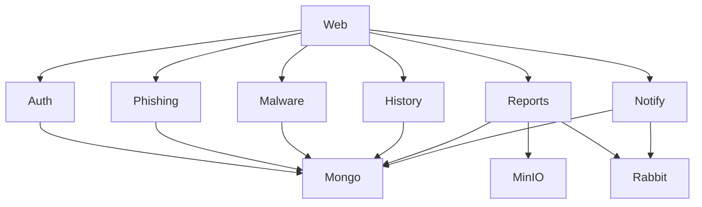

# Service Map

## Services

| Service | Language | Direct port | Public route | Primary data | Status | Note |
|---|---|---:|---|---|---|---|
| Auth | Go | 8080 | `/auth` | MongoDB, Redis | Hosted build, store race and Auth/MFA contracts pass | [[Auth]] |
| Phishing | Rust | 8081 | `/phishing` | MongoDB | Build/auth gate/health pass; live Gemini analysis remains unverified | [[Phishing]] |
| Malware | Rust | 8082 | `/malware` | MongoDB | Build/auth gate/health pass; live VirusTotal analysis remains unverified | [[Malware]] |
| History | Go | 8083 | `/history` | MongoDB | Hosted owner/risk/cursor contracts pass; legacy rollback retained | [[History]] |
| Reports | Go | 8084 | `/reports` | MongoDB, RustFS, RabbitMQ | RS256 auth and ownership verified; artifact create/download verified | [[Reports]] |
| Notify | Go | 8085 | `/notify` | MongoDB, RabbitMQ | Owner API and Go broker contracts pass; operational drills remain | [[Notify]] |
| Web | React + Vite | 3000 | `/` | HttpOnly session cookie | Existing browser CI passes; MFA/TypeScript/redesign remain separate | [[Web]] |

Auth, History, and Notify share `apps/controlplane-go` and run as separate processes. The language rollback overlay selects the retained Rust/TypeScript/Python implementations against the same data and keys. Merged backend and hosted verification: [[2026-11-09-backend-control-plane-pr]].

Every service registers its full public prefix, and the gateway does not rewrite paths (D1=B, [[ADR-0004-gateway-prefix-contract]]). The public route, direct-port path, and service route are identical; `scripts/check-routes.mjs` enforces the contract.

## Infrastructure

| Component | Image | Host port | Purpose |
|---|---|---:|---|
| Traefik | `traefik:v3.7` | 8088 (HTTP), 8000 (dashboard) | Edge proxy and path routing |
| MongoDB | `mongo:6.0` | 27017 | Primary document store |
| Redis | `redis:7-alpine` | 6379 | Cache and session support |
| RabbitMQ | `rabbitmq:3-management` | 5672, 15672 | Asynchronous events |
| RustFS | `ghcr.io/rustfs/rustfs:1.0.1-glibc` (AMD64 digest pinned in Compose) | 9000, 9001 | S3-compatible report object storage |

## Dependency direction

## Status legend

| Status | Meaning |
|---|---|
| Healthy | Builds, starts, and passes its smoke test |
| Unverified | No reliable build or smoke test evidence yet |
| Broken build | Does not compile or image does not build |
| Security defects | Starts, but auth or ownership checks are missing or incorrect |
| Routing defects | Gateway and service disagree about paths |

## Related notes

- [[Architecture-Review]]
- [[System-Overview]]
- [[Data-Flow]]
- [[Gateway-Routing]]
- [[Ports]]
- [[Test-Matrix]]
