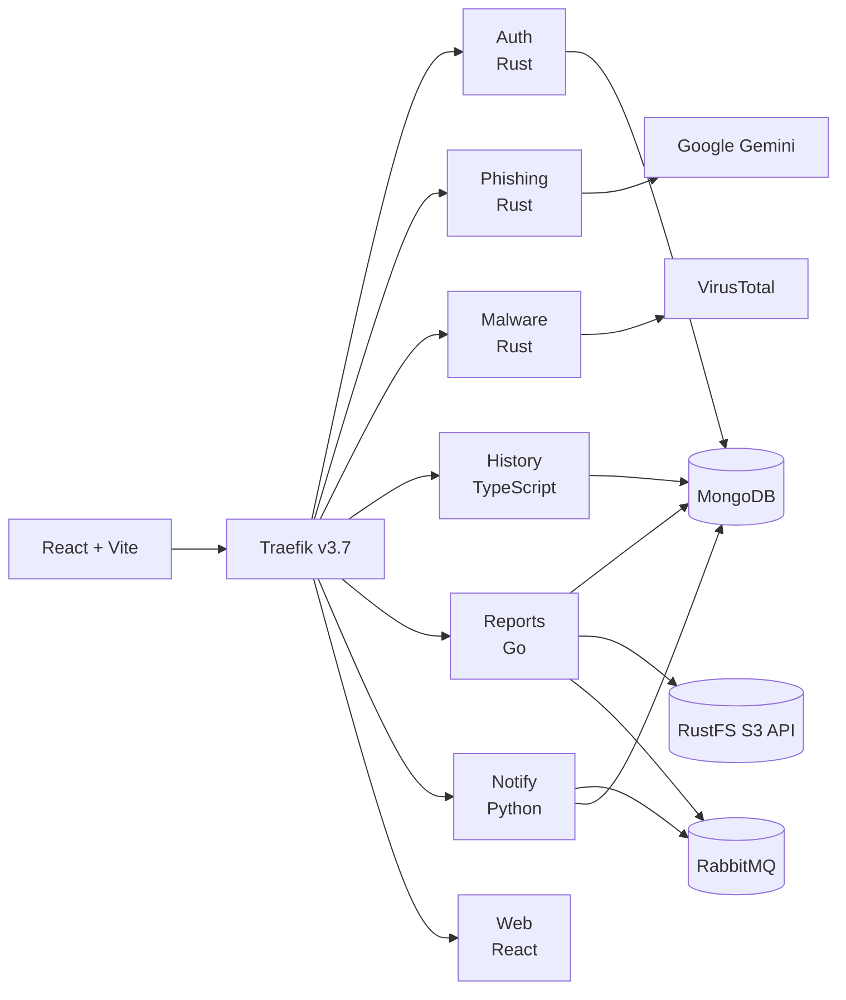

# System Overview

ForgeHarbor is a polyglot threat-detection platform. A React frontend talks to backend services through Traefik. The services use MongoDB, Redis, RabbitMQ, and RustFS, and call external threat-intelligence providers.

## Current shape

Redis is provisioned in Compose but is not used by the current service code. Treat it as reserved capacity for caching, sessions, or rate limiting.

## Assessment

The 2026-11-02 review found that the services share infrastructure but not contracts: routing conventions differ per service, auth is re-implemented per service, three services write the same collection with different shapes, and the queue producer and consumer never meet. The full findings, evidence, target shape, and decisions are in [[Architecture-Review]].

## Language boundaries

| Language | Specialty | Current services | Target direction |
|---|---|---|---|
| Rust | CPU-heavy, memory-safe analysis | Auth, Phishing, Malware | Keep for the malware analysis engine; move ordinary I/O services to Go if they are rewritten |
| Go | Control-plane APIs and orchestration | Reports | Add the scan orchestrator and make Go the default for ordinary backend services |
| Python | AI, threat intelligence, feed normalization | Notify | Add a threat-intelligence service and use Python for AI-heavy enrichment |
| TypeScript | User interface and API integration | Web, History | Keep React + TypeScript for the UI; TypeScript is acceptable for read-heavy CRUD |
| SQL | Relational data and reporting | Not used yet | Move users, scans, reports, and audit records to PostgreSQL |

The polyglot split is intentional. The goal is credible specialty, not language count. See [[ADR-0001-polyglot-boundaries]] and [[ADR-0002-go-control-plane]].

## Current versus target

| Concern | Current | Target |
|---|---|---|
| Scan execution | Synchronous request path | Asynchronous orchestrator with retries and timeouts |
| Data store | MongoDB for most records | PostgreSQL for relational records; MongoDB only for flexible documents |
| Threat intelligence | Direct calls from scan services | Dedicated Python service with caching and rate limits |
| Notifications | Queue consumer with auth and naming gaps | Authenticated consumer with retries and a dead-letter queue |
| Observability | Logs only | OpenTelemetry traces and structured logs |
| Contracts | Hand-written frontend calls | OpenAPI or protobuf contracts checked in |
| Routing | One prefix convention (D1=B); Traefik provider fixed | All documented routes and anonymous-auth checks pass the contract test |
| Auth boundary | Re-implemented in each service | Validated once at the edge; trusted identity downstream |
| Secrets | Every application context excludes `.env` and PEMs; public JWT key is mounted read-only; provider credential validity is unverified | Runtime secrets, rotated local credentials, and closed infrastructure ports |

## Known blockers

- Reports uses the pinned RustFS S3-compatible development image; authenticated artifact create/download has been verified end to end.
- History, Reports, and Notify verify RS256 tokens and scope reads to the token subject; edge validation is not centralized. Development host ports are loopback-only; production deployment exposure is not defined.
- Compose no longer overrides provider keys with blanks; local credential validity has not been checked.
- Reports and Notify share the `notifications` queue, but a versioned event envelope and retry/dead-letter policy remain future work.

## Resolved in Phase 0

- All three Rust services build on pinned stable Rust 1.90.0; the nightly async-drop cycle is gone.
- The gateway prefix contract is decided and applied (D1=B); a route-contract test exists.
- The Auth image no longer copies `config`; Phishing and Malware copy only the public key.

## Related notes

- [[Architecture-Review]]
- [[Service-Map]]
- [[Data-Flow]]
- [[Gateway-Routing]]
- [[Security-Review]]
- [[Roadmap]]
