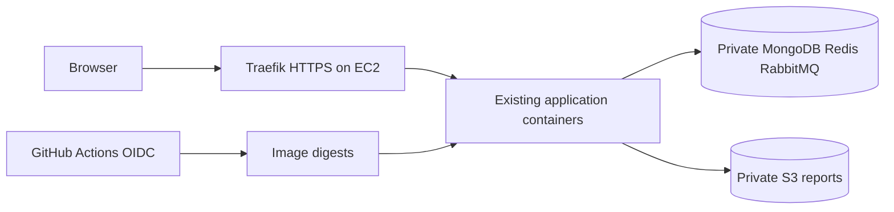

# AWS resume-demo deployment

## Scope correction

ForgeHarbor is a resume project, not a customer SaaS launch. The earlier managed Fargate/Atlas/MQ recommendation near $500/month is withdrawn for this scope. Build a reproducible, secure demonstration that can be shut down when not needed. No cloud spending or account changes are approved by this document.

## Recommended architecture

One Linux x86-64 EC2 host runs the existing application, MongoDB, Redis and RabbitMQ through an explicit production/demo Compose configuration. Candidate size: 2 vCPU / 8 GiB, validated by memory, Argon2 and concurrent scan measurements; build images in CI, not on the demo host. Use encrypted EBS for state. All backend and data ports stay unpublished; only Traefik HTTPS and the ACME HTTP challenge/redirect are public. Disable the insecure dashboard and prefer static file-provider routing over a Docker socket mount.

Use ECR for immutable images, a private encrypted/versioned S3 bucket for report objects, Secrets Manager for fresh cloud secrets, SSM for administration without SSH, and CloudWatch with short retention for logs/health/cost alarms. Keep MongoDB/Redis/RabbitMQ local to this demo host; single-host downtime and data recovery limitations must be stated openly.

## Ordered AWS work

1. Add AWS credential-chain mode to Reports. Its current static credentials/custom endpoint are for RustFS; use regional S3 and an appropriately scoped role in AWS. Retain local compatibility and test temporary credentials and owner-authorized create/download/cleanup. Model the EC2 role as a shared host permission boundary; it is not per-service IAM isolation.
2. Add Terraform for the dedicated VPC/subnet, security groups, EC2/EBS, S3/ECR, IAM/OIDC, secret references, logs and budget alarms. Use a nonoverlapping Docker/VPC CIDR. Select supported pinned MongoDB/Redis/RabbitMQ images and verify upgrades separately.
3. Add a demo Compose configuration with real hostname, HTTPS, Secure cookies, exact origins, stable trusted proxy peer, resource limits and safe key mounts. Do not inherit development ports, localhost routing or insecure dashboards. Prove spoofed forwarding headers cannot bypass rate limits.
4. Build/scan once in GitHub Actions; push commit-tagged ECR images and record digests. Use OIDC roles scoped to this repository and environment. Deploy approved release manifests through a restricted SSM document; retain the previous compatible release for rollback. No permanent AWS keys in GitHub.
5. Verify signup/login/MFA/recovery, owner isolation, report storage and notifications on AWS. Use new test keys and bounded provider calls; do not copy local secrets or real user data. Rehearse restoration of MongoDB, report objects and MFA key; record Redis revocation-loss and broker-recovery limitations.
6. Produce the resume evidence: architecture diagram, CI/deployment/rollback run links, sanitized screenshots, cost notes and a concise demo recording. Describe verified capabilities and limitations; make no uptime, accuracy or scalability claims without measurements.

## Cost and run policy

Plan roughly $100–150/month for continuous light usage, subject to a selected-region estimate and workload sizing. This is an engineering allowance, not an AWS quote or approved budget. Prefer on-demand demonstration windows; stopping compute does not remove EBS, S3, snapshots, retained IPs, secrets or logs charges. Do not schedule automatic startup/shutdown until explicitly requested.

For comparison only, the official T3 table publishes US East Linux rates; it is not a Mumbai quote. Model 730 monthly hours, one public IPv4, EBS, backup retention, ECR/S3, logs, secrets and transfer in AWS Pricing Calculator. Exclude provider API usage, taxes and domain registration from any infrastructure-only subtotal. Set alerts and request/provider quotas: budget alerts do not enforce a hard spending cap. Avoid always-on ALB/NAT/managed database baseline costs for this single-host demonstration unless a measured requirement justifies them.

Sources researched 2026-11-11: [EC2 T3](https://aws.amazon.com/ec2/instance-types/t3/), [VPC/IPv4 pricing](https://aws.amazon.com/vpc/pricing/), [EBS pricing](https://aws.amazon.com/ebs/pricing/), [AWS Pricing Calculator](https://calculator.aws/), [SSM](https://docs.aws.amazon.com/systems-manager/latest/userguide/session-manager.html), [GitHub OIDC](https://docs.aws.amazon.com/IAM/latest/UserGuide/id_roles_create_for-idp_oidc.html).

## Acceptance and remaining inputs

Region/domain/account, final cost estimate, provider test credentials and data scope are still inputs before provisioning. Successful local/hosted CI is not an AWS deployment. A resume demo does not establish production HA, compliance or security certification.

- [[Deploy]]
- [[Backlog]]
- [[Security-Review]]
