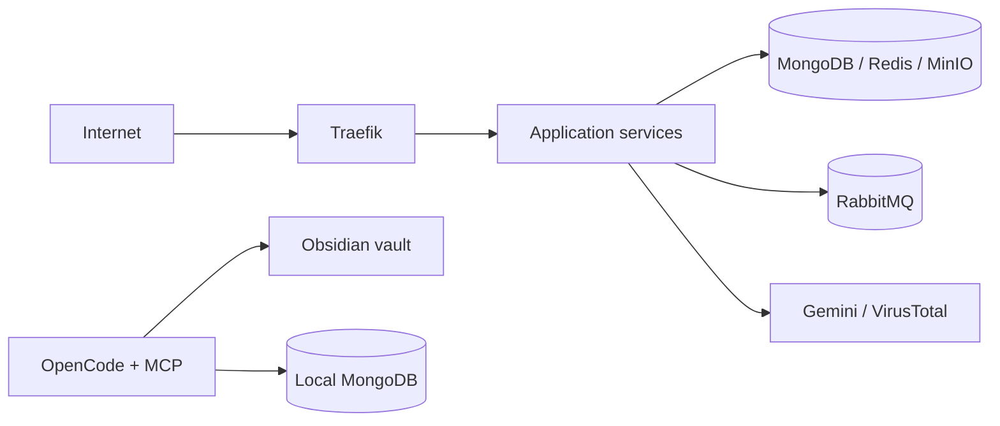

# Threat Model

## Assets

| Asset | Why it matters |
|---|---|
| User credentials | Account takeover |
| JWTs and signing keys | Identity forgery across services |
| Scan inputs and results | Sensitive URLs, filenames, and verdicts |
| Reports | Stored objects and metadata |
| Notifications | User-specific events |
| Provider API keys | Financial and reputational cost |
| Message queue | Event integrity and delivery |
| Audit trail | Investigation and non-repudiation |

## Actors

- Anonymous internet user
- Authenticated user
- Malicious or careless insider
- Compromised dependency or container image
- External provider outage or compromise

## Trust boundaries

## Threats

| Threat | Example | Impact | Mitigation |
|---|---|---|---|
| Spoofing | Forged JWT accepted by History | Account takeover | Verify RS256 signature, issuer, audience, expiry; fail closed |
| Tampering | Client submits arbitrary report content | Stored injection or false evidence | Generate reports server-side from trusted scan data |
| Repudiation | No audit log for sensitive actions | Cannot investigate abuse | Append-only audit events |
| Information disclosure | Anonymous History or Notify reads | Cross-user data leak | Auth and ownership checks on every read |
| Denial of service | Large file upload or repeated scans | Memory and provider exhaustion | Size limits, rate limits, queues, timeouts |
| Elevation of privilege | Direct service port bypasses gateway | Weakens routing and auth boundary | Internal-only service network in production |
| Supply chain | Old or compromised dependency | Code execution or data loss | Pin, scan, and update dependencies |
| Secret exposure | Keys in `.env` or shell history | Provider and signing-key compromise | Secret manager, rotation, least privilege |

## Assumptions

- The local Compose stack is for development, not production.
- TLS is terminated outside the current stack.
- The Obsidian vault contains no secrets.
- MCP MongoDB access remains read-only.
- Provider keys are scoped and rotated.

## Open questions

- Will Auth stay in Rust, move to Go, or be replaced by an identity provider?
- Will PostgreSQL replace MongoDB for relational records?
- What is the retention policy for scans and reports?
- Which audit events are legally or operationally required?

## Related notes

- [[Security-Review]]
- [[ADR-0001-polyglot-boundaries]]
- [[ADR-0002-go-control-plane]]
- [[Roadmap]]
